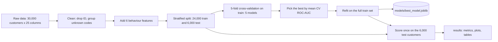
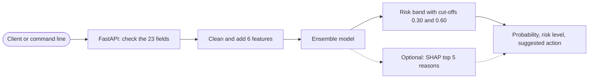
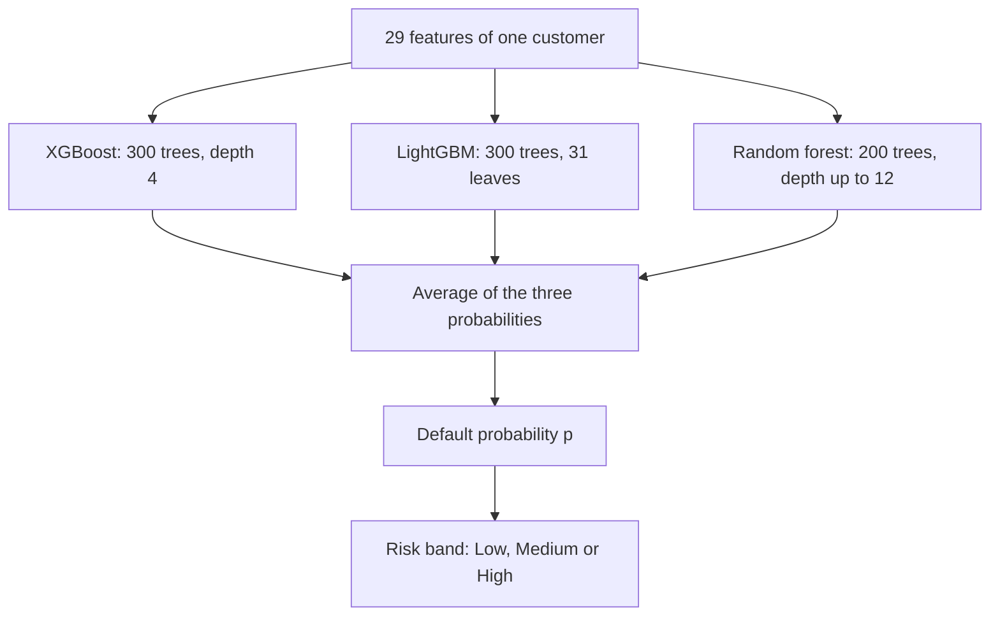
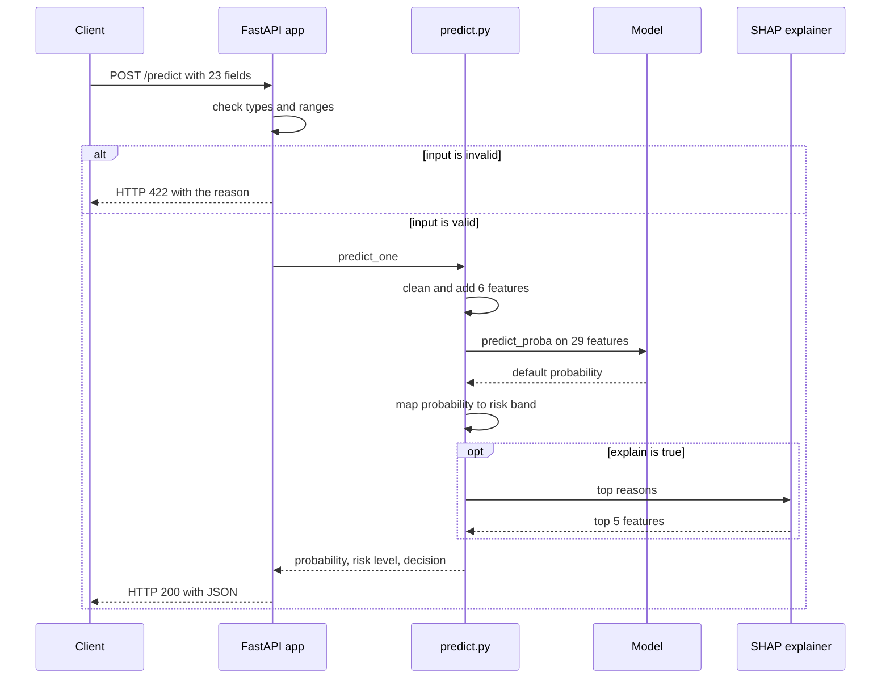
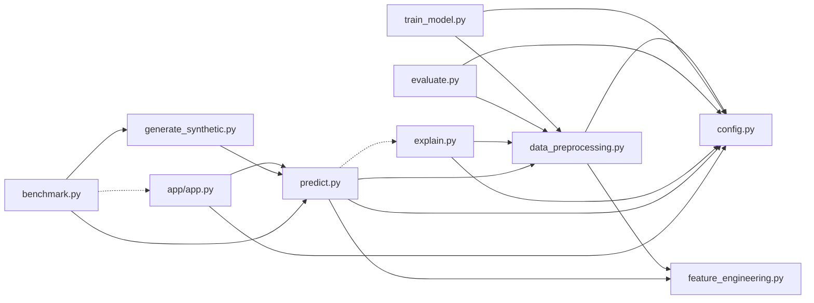

# Concept Sketches, Equations and Models

All diagrams are written in Mermaid, so GitHub draws them automatically when you open this file.

## 1. System overview

### 1.1 Training pipeline (run once, or when new data arrives)

### 1.2 Scoring pipeline (every time a customer is scored)

## 2. How the data changes shape

| Step | Columns | Rows | Note |
|---|---|---|---|
| Raw file | 25 (`ID`, 23 inputs, `default`) | 30,000 | `data/raw/credit_data.csv` |
| After cleaning | 24 (23 inputs, `default`) | 30,000 | `ID` dropped, unknown codes grouped |
| After feature engineering | 30 (29 inputs, `default`) | 30,000 | 6 new columns |
| Training set | 29 inputs + target | 24,000 | 22.1% defaulters |
| Test set | 29 inputs + target | 6,000 | 22.1% defaulters, kept apart |
| One customer at scoring time | 23 fields in, 29 features inside | 1 | one probability out |

## 3. Structure of the chosen model

## 4. What happens during one API request

## 5. How the code modules depend on each other

An arrow means "uses". A dotted arrow means "uses only when needed".

## 6. Equations

| Name | Equation | Meaning of the symbols |
|---|---|---|
| Logistic model | `z = b0 + b1*x1 + ... + b29*x29`, `p = 1 / (1 + exp(-z))` | `x` features, `b` weights, `p` default probability |
| Log loss | `-(1/n) * sum[ y*log(p) + (1-y)*log(1-p) ]` | `y` = 1 if the customer defaulted, else 0 |
| Gradient boosting | `F_m(x) = F_(m-1)(x) + eta * h_m(x)` | `h_m` the m-th small tree, `eta` learning rate 0.05 |
| Random forest | `p(x) = (1/T) * sum of p_t(x)` | `T` = 200 trees |
| Soft-voting ensemble | `p(x) = (p_xgb + p_lgbm + p_rf) / 3` | average of three probabilities |
| Risk band | Low if `p < 0.30`; Medium if `0.30 <= p < 0.60`; High if `p >= 0.60` | cut-offs in `src/config.py` |
| Average repayment delay | `(PAY_0 + PAY_2 + ... + PAY_6) / 6` | six monthly statuses |
| Worst repayment delay | `max(PAY_0, PAY_2, ..., PAY_6)` | worst month |
| Payment-to-bill ratio | `avg_payment / (max(avg_bill, 0) + 1)` | average paid over average billed |
| Credit utilisation | `avg_bill / LIMIT_BAL` | share of the limit in use |
| Precision, recall, F1 | `TP/(TP+FP)`, `TP/(TP+FN)`, `2*P*R/(P+R)` | TP, FP, FN: true positives, false positives, false negatives |
| Brier score | `(1/n) * sum of (p_i - y_i)^2` | lower is better |
| ROC-AUC and Gini | `Gini = 2*AUC - 1` | AUC = chance a defaulter outscores a non-defaulter |
| KS statistic | `max over cut-offs of (TPR - FPR)` | TPR and FPR: true and false positive rates |
| SHAP additivity | `p(x) = phi_0 + phi_1 + ... + phi_29` | `phi_0` average prediction, `phi_j` effect of feature j |
| Cost-based cut-off | `t* = C_false_alarm / (C_false_alarm + C_miss)` | cost of a false alarm and of a missed default |

Derivations and plain-language explanations are in `docs/01_principle_note.md`.
