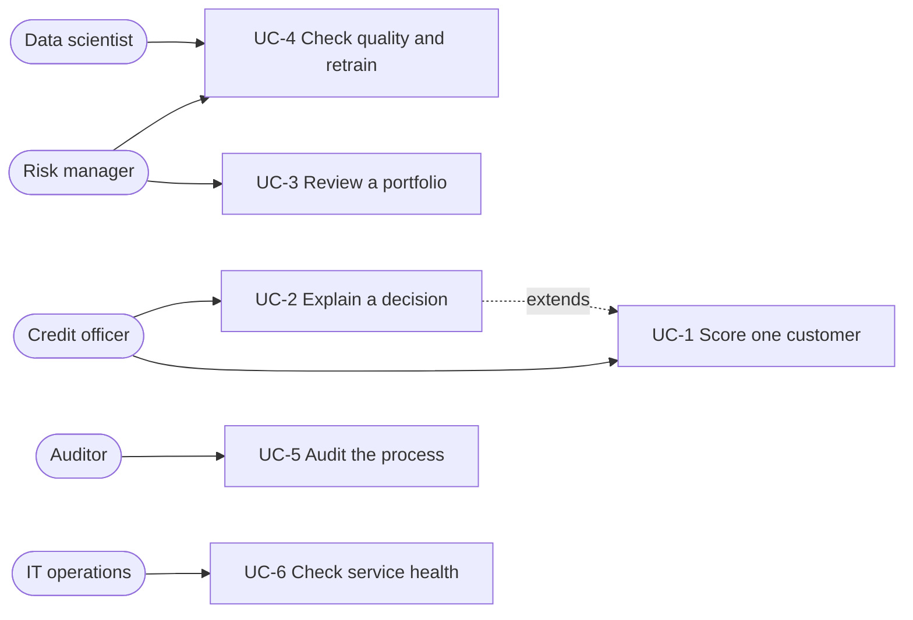

# Use Case and Stakeholder Definition

## 1. Purpose of the system

A bank (or card issuer) uses this system to estimate how likely a credit card customer is to miss
the next payment, to place the customer in a Low / Medium / High risk band, and to see the main
reasons behind the result. The system **supports** a human decision. It does not replace it.

## 2. Stakeholders

| Stakeholder | Role | What they need from the system | How the project serves them | Main concern |
|---|---|---|---|---|
| Credit officer | Decides on limits and approvals for individual customers | A fast answer and a reason they can repeat to the customer | `/predict` returns probability and risk level; `explain=true` adds the top 5 reasons | Trusting a score they cannot explain |
| Credit risk manager | Owns portfolio risk and the approval policy | Proof that the model separates good and bad customers, and control of the cut-offs | `results/metrics.json`, `results/risk_band_summary.csv`, `results/threshold_table.csv`, cut-offs in `src/config.py` | Wrong cut-offs causing losses or lost business |
| Customer (applicant) | Person whose credit is judged | A fair decision and an explanation | Reasons per customer; sensitive inputs listed openly in `docs/data_dictionary.md` | Being treated unfairly because of sex, age or marital status |
| Compliance officer / auditor | Checks fairness, privacy and documentation | A reproducible, documented process | Fixed seed, one command per stage, tests, risk register | Unexplainable or biased decisions |
| Data scientist (maintainer) | Trains and improves the model | Clean code, tests, a clear comparison of models | `src/` modules, `tests/`, `results/model_comparison.csv` | Silent errors such as test-data leakage |
| IT / operations | Runs the service | A simple, validated API with a health check | FastAPI app, `/health`, input validation, `requirements.txt` | Crashes, bad input, version problems |
| Bank management | Funds and approves the system | Lower credit losses, defensible decisions | Risk bands and metrics in plain terms | Cost and regulatory exposure |

## 3. Use cases

| ID | Use case | Actor | Trigger | Main steps | Result | Requirements |
|---|---|---|---|---|---|---|
| UC-1 | Score one customer | Credit officer | A customer applies or is reviewed | 1. Enter the 23 fields. 2. System validates them. 3. System returns probability and risk level. | Probability, Low / Medium / High, suggested action | FR-01 to FR-04 |
| UC-2 | Explain a decision | Credit officer, customer-facing staff | Customer asks "why?" | 1. Score the customer with `explain=true`. 2. System returns the top 5 factors and whether each raises or lowers risk. | Plain list of reasons | FR-05 |
| UC-3 | Review a whole portfolio | Credit risk manager | Monthly or quarterly review | 1. Upload a batch (API) or a CSV (command line). 2. System scores every customer. 3. Manager looks at the counts per band. | Scored list and risk-band counts | FR-06, FR-08 |
| UC-4 | Check model quality and retrain | Data scientist, risk manager | New data or a scheduled review | 1. Run preprocessing, training and evaluation. 2. Compare scores with the requirement targets. 3. Keep or replace the model. | Updated `results/` files | FR-09, FR-10 |
| UC-5 | Audit the process | Compliance officer, auditor | Internal or external audit | 1. Read the problem statement, requirements, data dictionary and risk register. 2. Re-run the commands. 3. Compare with the saved results. | Reproduced results and a documented trail | NFR-07 to NFR-11 |
| UC-6 | Check service health | IT / operations | Deployment or monitoring | Call `/health` | Status and loaded model name | FR-07 |

## 4. Use case diagram

## 5. How the risk level is used

| Default probability | Risk level | Suggested action | Who acts |
|---|---|---|---|
| below 0.30 | Low | Approve | Officer, using normal policy |
| 0.30 to below 0.60 | Medium | Manual review | Officer plus a second reviewer |
| 0.60 and above | High | Reject (recommendation) | A person confirms before the customer is told |

The cut-offs are provisional business
 in `src/config.py`. The bank decides the final values.

## 6. Out of scope

- Connecting to a real bank system, a customer database or a loan origination workflow.
- Deciding on the customer's behalf without human review.
- Legal or regulatory approval of the model.
